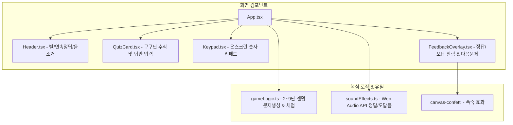

# 초등학교 2학년을 위한 구구단 연습 게임 구현 계획서 (Implementation Plan)

> **For agentic workers:** REQUIRED SUB-SKILL: Use superpowers:subagent-driven-development to implement this plan task-by-task. Steps use checkbox (`- [ ]`) syntax for tracking.

**Goal:** 초등학교 2학년 학생들을 위해 2단~9단 랜덤 구구단 문제를 출제하고, 온스크린 키패드/키보드로 답을 입력받아 정답("🎉 정답!")과 오답("아쉬워요! 정답은 ___이에요.")을 음향 및 시각 효과와 함께 피드백해 주는 반응형 웹 게임을 개발합니다.

**Architecture:** React + TypeScript + Vite 기반의 컴포넌트 아키텍처로 구성하며, Tailwind CSS로 초등학생 눈높이에 맞춘 파스텔/비비드 비주얼을 제공합니다. 외부 음원 의존성 없이 Web Audio API를 활용한 무지연 사운드 신디사이저와 Canvas Confetti를 연동합니다.

**Architecture Diagram:**



**Tech Stack:** 
- React 18/19, TypeScript, Vite
- Tailwind CSS, Lucide React, canvas-confetti
- Web Audio API (합성음 사운드 엔진)
- Vitest, @testing-library/react, @testing-library/jest-dom, jsdom

## Global Constraints
- Target Audience: 초등학교 2학년 (만 7~8세), 시인성 높은 큰 폰트와 밝고 친근한 비주얼 필수
- Range: 곱해지는 수 2~9단, 곱하는 수 1~9 (랜덤 1문제 출제)
- Exact Feedback Messages:
  - 정답: 큰 글씨의 "🎉 정답!" 및 축하 문구
  - 오답: "아쉬워요! 정답은 {num1 * num2}이에요."
- Input Support: 물리 키보드(숫자 및 Enter) + 화면 터치용 온스크린 숫자 키패드 지원
- No external audio asset dependency: 브라우저 Web Audio API 사용

---

### Task 1: Project Scaffolding & Setup

**Files:**
- Create: `package.json`
- Create: `vite.config.ts`
- Create: `tsconfig.json`
- Create: `tsconfig.node.json`
- Create: `tailwind.config.js`
- Create: `postcss.config.js`
- Create: `index.html`
- Create: `src/index.css`
- Create: `src/main.tsx`

**Interfaces:**
- Produces: 개발 서버 실행 환경 (`npm run dev`), 빌드 환경 (`npm run build`), 테스트 환경 (`npm run test`)

- [ ] **Step 1: package.json 및 종속성 설정 생성**

```json
{
  "name": "multiplication-table-game",
  "private": true,
  "version": "1.0.0",
  "type": "module",
  "scripts": {
    "dev": "vite",
    "build": "tsc && vite build",
    "preview": "vite preview",
    "test": "vitest run"
  },
  "dependencies": {
    "canvas-confetti": "^1.9.4",
    "lucide-react": "^1.16.0",
    "react": "^18.3.1",
    "react-dom": "^18.3.1"
  },
  "devDependencies": {
    "@testing-library/jest-dom": "^6.6.3",
    "@testing-library/react": "^16.2.0",
    "@types/canvas-confetti": "^1.9.0",
    "@types/node": "^22.13.0",
    "@types/react": "^18.3.18",
    "@types/react-dom": "^18.3.5",
    "@vitejs/plugin-react": "^4.3.4",
    "autoprefixer": "^10.4.20",
    "jsdom": "^26.0.0",
    "postcss": "^8.5.1",
    "tailwindcss": "^3.4.17",
    "typescript": "^5.7.3",
    "vite": "^6.1.0",
    "vitest": "^3.0.5"
  }
}
```

- [ ] **Step 2: TypeScript 및 Vite 설정 생성**

`vite.config.ts`:
```typescript
/// <reference types="vitest" />
import { defineConfig } from 'vite';
import react from '@vitejs/plugin-react';

export default defineConfig({
  plugins: [react()],
  test: {
    globals: true,
    environment: 'jsdom',
    setupFiles: './tests/setup.ts',
  },
});
```

- [ ] **Step 3: Tailwind CSS 및 PostCSS 설정 생성**

`tailwind.config.js`:
```javascript
/** @type {import('tailwindcss').Config} */
export default {
  content: ['./index.html', './src/**/*.{js,ts,jsx,tsx}'],
  theme: {
    extend: {
      animation: {
        'bounce-short': 'bounce 0.5s ease-in-out 2',
        'wiggle': 'wiggle 0.3s ease-in-out infinite',
      },
      keyframes: {
        wiggle: {
          '0%, 100%': { transform: 'rotate(-3deg)' },
          '50%': { transform: 'rotate(3deg)' },
        }
      }
    },
  },
  plugins: [],
};
```

- [ ] **Step 4: 종속성 설치 실행**

Run: `npm install`
Expected: 설치 성공

- [ ] **Step 5: Commit**

```bash
git add package.json package-lock.json vite.config.ts tsconfig.json tailwind.config.js postcss.config.js index.html src/index.css src/main.tsx
git commit -m "chore: scaffold react vite project with tailwind and vitest"
```

---

### Task 2: Core Game Logic & Unit Tests

**Files:**
- Create: `src/utils/gameLogic.ts`
- Create: `tests/setup.ts`
- Create: `tests/gameLogic.test.ts`

**Interfaces:**
- Produces:
  - `interface Question { num1: number; num2: number; answer: number; }`
  - `function generateQuestion(prev?: Question): Question`
  - `function checkAnswer(question: Question, inputStr: string): { isCorrect: boolean; answer: number; message: string; }`

- [ ] **Step 1: Write the failing test for gameLogic**

`tests/gameLogic.test.ts`:
```typescript
import { describe, it, expect } from 'vitest';
import { generateQuestion, checkAnswer, Question } from '../src/utils/gameLogic';

describe('gameLogic', () => {
  it('generates a question within 2~9 dan and 1~9 multiplier', () => {
    for (let i = 0; i < 100; i++) {
      const q = generateQuestion();
      expect(q.num1).toBeGreaterThanOrEqual(2);
      expect(q.num1).toBeLessThanOrEqual(9);
      expect(q.num2).toBeGreaterThanOrEqual(1);
      expect(q.num2).toBeLessThanOrEqual(9);
      expect(q.answer).toBe(q.num1 * q.num2);
    }
  });

  it('avoids immediately repeating the exact same question', () => {
    const prev: Question = { num1: 3, num2: 4, answer: 12 };
    for (let i = 0; i < 50; i++) {
      const q = generateQuestion(prev);
      expect(q.num1 === prev.num1 && q.num2 === prev.num2).toBe(false);
    }
  });

  it('correctly grades right answer', () => {
    const q: Question = { num1: 7, num2: 8, answer: 56 };
    const res = checkAnswer(q, '56');
    expect(res.isCorrect).toBe(true);
    expect(res.answer).toBe(56);
  });

  it('correctly grades wrong answer with required message format', () => {
    const q: Question = { num1: 6, num2: 4, answer: 24 };
    const res = checkAnswer(q, '20');
    expect(res.isCorrect).toBe(false);
    expect(res.answer).toBe(24);
    expect(res.message).toBe('아쉬워요! 정답은 24이에요.');
  });
});
```

- [ ] **Step 2: Run test to verify it fails**

Run: `npm test`
Expected: FAIL (Cannot find module `../src/utils/gameLogic`)

- [ ] **Step 3: Implement gameLogic.ts**

`src/utils/gameLogic.ts`:
```typescript
export interface Question {
  num1: number; // 2 ~ 9
  num2: number; // 1 ~ 9
  answer: number;
}

export function generateQuestion(prev?: Question): Question {
  let num1: number;
  let num2: number;

  do {
    // 2단부터 9단까지
    num1 = Math.floor(Math.random() * 8) + 2;
    // 1부터 9까지
    num2 = Math.floor(Math.random() * 9) + 1;
  } while (prev && prev.num1 === num1 && prev.num2 === num2);

  return {
    num1,
    num2,
    answer: num1 * num2,
  };
}

export interface CheckResult {
  isCorrect: boolean;
  answer: number;
  message: string;
}

export function checkAnswer(question: Question, inputStr: string): CheckResult {
  const trimmed = inputStr.trim();
  const numericInput = parseInt(trimmed, 10);
  const isCorrect = numericInput === question.answer;

  return {
    isCorrect,
    answer: question.answer,
    message: isCorrect
      ? '정답'
      : `아쉬워요! 정답은 ${question.answer}이에요.`,
  };
}
```

- [ ] **Step 4: Run test to verify it passes**

Run: `npm test`
Expected: PASS 4 tests in `tests/gameLogic.test.ts`

- [ ] **Step 5: Commit**

```bash
git add src/utils/gameLogic.ts tests/setup.ts tests/gameLogic.test.ts
git commit -m "feat: implement game logic with random 2-9 questions and grading"
```

---

### Task 3: Web Audio Sound Synthesizer

**Files:**
- Create: `src/utils/soundEffects.ts`
- Create: `tests/soundEffects.test.ts`

**Interfaces:**
- Produces:
  - `playCorrectSound(): void` (경쾌한 도-미-솔-도 화음 재생)
  - `playWrongSound(): void` (부드러운 하향 단조 격려음 재생)
  - `playClickSound(): void` (짧은 팝 클릭음)
  - `toggleMute(): boolean`
  - `getMuted(): boolean`

- [ ] **Step 1: Write test for soundEffects state management**

`tests/soundEffects.test.ts`:
```typescript
import { describe, it, expect } from 'vitest';
import { getMuted, toggleMute, setMuted } from '../src/utils/soundEffects';

describe('soundEffects', () => {
  it('toggles mute status correctly', () => {
    setMuted(false);
    expect(getMuted()).toBe(false);
    expect(toggleMute()).toBe(true);
    expect(getMuted()).toBe(true);
    expect(toggleMute()).toBe(false);
  });
});
```

- [ ] **Step 2: Run test to verify it fails**

Run: `npm test`
Expected: FAIL (Cannot find module `../src/utils/soundEffects`)

- [ ] **Step 3: Implement soundEffects.ts**

`src/utils/soundEffects.ts`:
```typescript
let isMuted = false;
let audioCtx: AudioContext | null = null;

function getAudioContext(): AudioContext | null {
  if (typeof window === 'undefined') return null;
  const AudioContextClass = window.AudioContext || (window as unknown as { webkitAudioContext: typeof AudioContext }).webkitAudioContext;
  if (!AudioContextClass) return null;
  if (!audioCtx) {
    audioCtx = new AudioContextClass();
  }
  if (audioCtx.state === 'suspended') {
    audioCtx.resume();
  }
  return audioCtx;
}

export function getMuted(): boolean {
  return isMuted;
}

export function setMuted(muted: boolean): void {
  isMuted = muted;
}

export function toggleMute(): boolean {
  isMuted = !isMuted;
  return isMuted;
}

export function playClickSound(): void {
  if (isMuted) return;
  const ctx = getAudioContext();
  if (!ctx) return;

  const osc = ctx.createOscillator();
  const gain = ctx.createGain();
  osc.type = 'sine';
  osc.frequency.setValueAtTime(600, ctx.currentTime);
  osc.frequency.exponentialRampToValueAtTime(300, ctx.currentTime + 0.05);

  gain.gain.setValueAtTime(0.2, ctx.currentTime);
  gain.gain.exponentialRampToValueAtTime(0.01, ctx.currentTime + 0.05);

  osc.connect(gain);
  gain.connect(ctx.destination);

  osc.start();
  osc.stop(ctx.currentTime + 0.05);
}

export function playCorrectSound(): void {
  if (isMuted) return;
  const ctx = getAudioContext();
  if (!ctx) return;

  // 도-미-솔-도 (C5, E5, G5, C6) 아르페지오
  const notes = [523.25, 659.25, 783.99, 1046.5];
  notes.forEach((freq, idx) => {
    const osc = ctx.createOscillator();
    const gain = ctx.createGain();
    const startTime = ctx.currentTime + idx * 0.09;

    osc.type = 'triangle';
    osc.frequency.setValueAtTime(freq, startTime);

    gain.gain.setValueAtTime(0.3, startTime);
    gain.gain.exponentialRampToValueAtTime(0.001, startTime + 0.25);

    osc.connect(gain);
    gain.connect(ctx.destination);

    osc.start(startTime);
    osc.stop(startTime + 0.25);
  });
}

export function playWrongSound(): void {
  if (isMuted) return;
  const ctx = getAudioContext();
  if (!ctx) return;

  // 따뜻한 격려음: 솔 -> 미 (하향)
  const notes = [392.00, 329.63];
  notes.forEach((freq, idx) => {
    const osc = ctx.createOscillator();
    const gain = ctx.createGain();
    const startTime = ctx.currentTime + idx * 0.16;

    osc.type = 'sine';
    osc.frequency.setValueAtTime(freq, startTime);

    gain.gain.setValueAtTime(0.25, startTime);
    gain.gain.exponentialRampToValueAtTime(0.001, startTime + 0.3);

    osc.connect(gain);
    gain.connect(ctx.destination);

    osc.start(startTime);
    osc.stop(startTime + 0.3);
  });
}
```

- [ ] **Step 4: Run test to verify it passes**

Run: `npm test`
Expected: PASS

- [ ] **Step 5: Commit**

```bash
git add src/utils/soundEffects.ts tests/soundEffects.test.ts
git commit -m "feat: implement Web Audio API sound synthesizer"
```

---

### Task 4: Interactive UI Components (Header, QuizCard, Keypad, FeedbackOverlay)

**Files:**
- Create: `src/components/Header.tsx`
- Create: `src/components/QuizCard.tsx`
- Create: `src/components/Keypad.tsx`
- Create: `src/components/FeedbackOverlay.tsx`
- Create: `tests/components.test.tsx`

**Interfaces:**
- `Header`: `{ score: number; streak: number; stars: number; isMuted: boolean; onToggleMute: () => void; }`
- `QuizCard`: `{ question: Question; userAnswer: string; onChangeAnswer: (val: string) => void; onSubmit: () => void; isShaking: boolean; disabled: boolean; }`
- `Keypad`: `{ onKeyPress: (num: string) => void; onDelete: () => void; onSubmit: () => void; disabled: boolean; }`
- `FeedbackOverlay`: `{ status: 'correct' | 'wrong'; answer: number; message: string; onNext: () => void; }`

- [ ] **Step 1: Write tests for QuizCard & FeedbackOverlay**

`tests/components.test.tsx`:
```typescript
import { describe, it, expect, vi } from 'vitest';
import { render, screen, fireEvent } from '@testing-library/react';
import React from 'react';
import { QuizCard } from '../src/components/QuizCard';
import { FeedbackOverlay } from '../src/components/FeedbackOverlay';

describe('UI Components', () => {
  it('renders QuizCard formula properly', () => {
    const question = { num1: 4, num2: 7, answer: 28 };
    render(
      <QuizCard
        question={question}
        userAnswer=""
        onChangeAnswer={() => {}}
        onSubmit={() => {}}
        isShaking={false}
        disabled={false}
      />
    );
    expect(screen.getByText('4')).toBeInTheDocument();
    expect(screen.getByText('×')).toBeInTheDocument();
    expect(screen.getByText('7')).toBeInTheDocument();
  });

  it('renders Correct feedback overlay with big 정답', () => {
    render(
      <FeedbackOverlay
        status="correct"
        answer={28}
        message="정답"
        onNext={() => {}}
      />
    );
    expect(screen.getByText(/정답/)).toBeInTheDocument();
  });

  it('renders Wrong feedback with required message', () => {
    render(
      <FeedbackOverlay
        status="wrong"
        answer={28}
        message="아쉬워요! 정답은 28이에요."
        onNext={() => {}}
      />
    );
    expect(screen.getByText('아쉬워요! 정답은 28이에요.')).toBeInTheDocument();
  });
});
```

- [ ] **Step 2: Run test to verify it fails**

Run: `npm test`
Expected: FAIL (Cannot find modules)

- [ ] **Step 3: Implement components**

Implement:
- `src/components/Header.tsx`
- `src/components/QuizCard.tsx`
- `src/components/Keypad.tsx`
- `src/components/FeedbackOverlay.tsx`

- [ ] **Step 4: Run tests to verify they pass**

Run: `npm test`
Expected: PASS

- [ ] **Step 5: Commit**

```bash
git add src/components/*.tsx tests/components.test.tsx
git commit -m "feat: add Header, QuizCard, Keypad, and FeedbackOverlay components"
```

---

### Task 5: Main Game App Integration & Full Keyboard/Touch Flow

**Files:**
- Create/Modify: `src/App.tsx`
- Create: `tests/App.test.tsx`

**Interfaces:**
- Integrated main game loop:
  - Generates initial question
  - Connects physical keyboard `0-9`, `Backspace`, `Enter`
  - Connects keypad clicks
  - Confetti explosion on correct answer
  - Audio playback on submit / next
  - Score, streak, stars tracking

- [ ] **Step 1: Write integration test for full answering cycle**

`tests/App.test.tsx`:
```typescript
import { describe, it, expect } from 'vitest';
import { render, screen, fireEvent } from '@testing-library/react';
import React from 'react';
import App from '../src/App';

describe('App Integration', () => {
  it('renders initial game screen with question and keypad', () => {
    render(<App />);
    expect(screen.getByText(/구구단/)).toBeInTheDocument();
    expect(screen.getByRole('button', { name: /확인/i })).toBeInTheDocument();
    expect(screen.getByText('1')).toBeInTheDocument();
    expect(screen.getByText('9')).toBeInTheDocument();
  });
});
```

- [ ] **Step 2: Run test to verify it fails**

Run: `npm test`
Expected: FAIL or passes if App already exists

- [ ] **Step 3: Implement App.tsx**

Write full React app with state hooks, keyboard event listeners, confetti triggers, and animations.

- [ ] **Step 4: Run tests to verify all pass**

Run: `npm test`
Expected: PASS all tests

- [ ] **Step 5: Commit**

```bash
git add src/App.tsx tests/App.test.tsx
git commit -m "feat: complete multiplication table game integration with keyboard and touch support"
```

---

### Task 6: E2E Browser Verification & Production Build

**Files:**
- Verify: `npm run build`
- Run and check in Playwright / Browser:
  - 2~9단 랜덤 문제 출제 확인
  - 온스크린 키패드 입력 및 백스페이스 동작 확인
  - 정답 제출 시 "🎉 정답!" 크게 표시 및 별 획득 확인
  - 오답 제출 시 "아쉬워요! 정답은 ___이에요." 문구 표시 확인
  - 다음 문제 버튼 클릭 시 새 문제로 리셋 확인

- [ ] **Step 1: Run production build**

Run: `npm run build`
Expected: Build succeeds with 0 errors

- [ ] **Step 2: Start preview or dev server & verify functionality in browser**

Run: Playwright browser test or verify web app in browser
Expected: All visual elements, responsive layout, correct/wrong messages verified

- [ ] **Step 3: Commit and summarize**

```bash
git add .
git commit -m "chore: verify production build and browser functionality"
```
